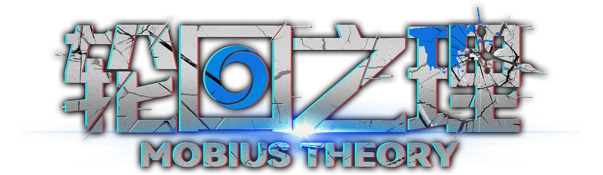
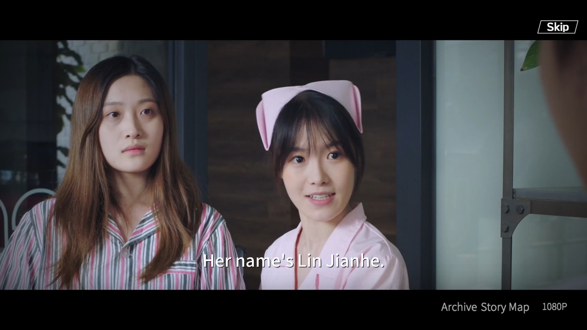
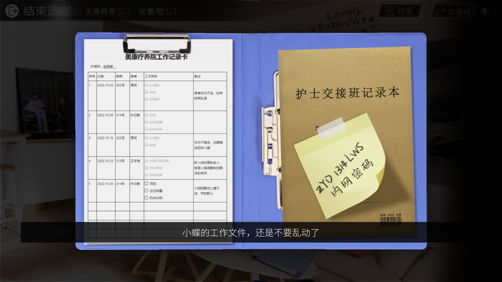
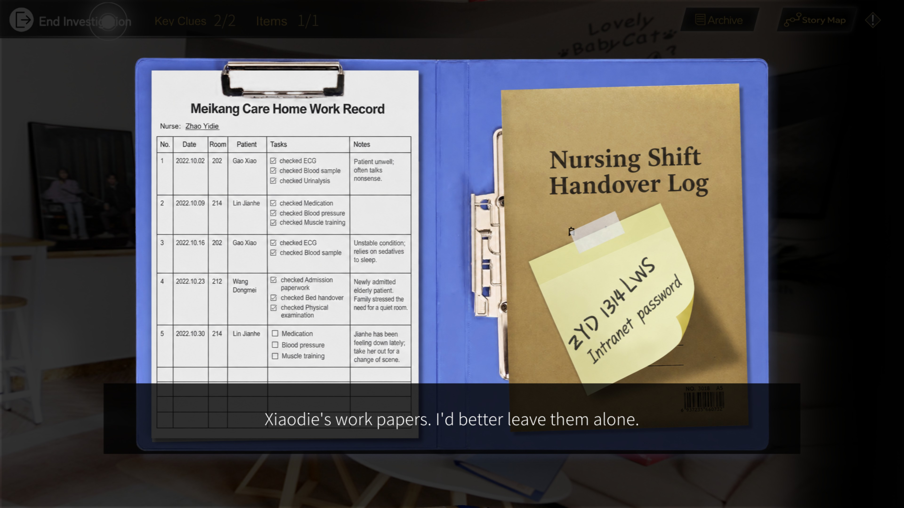
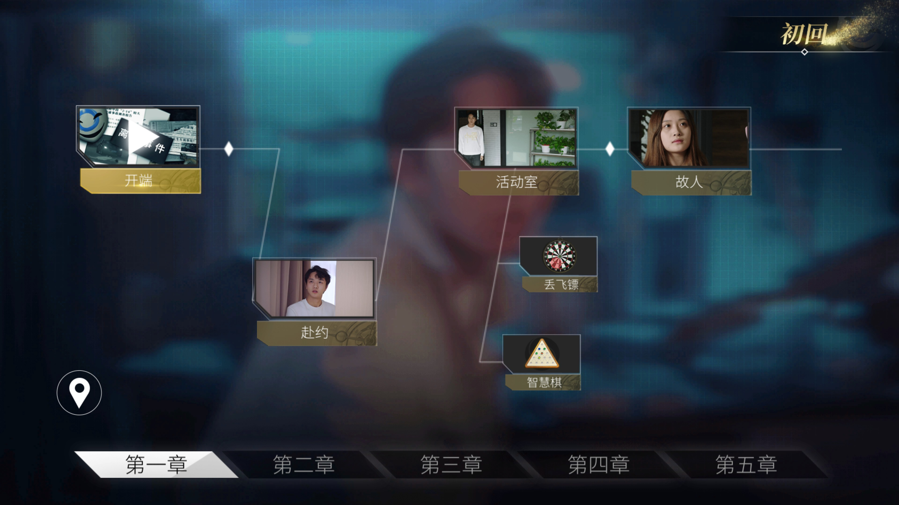
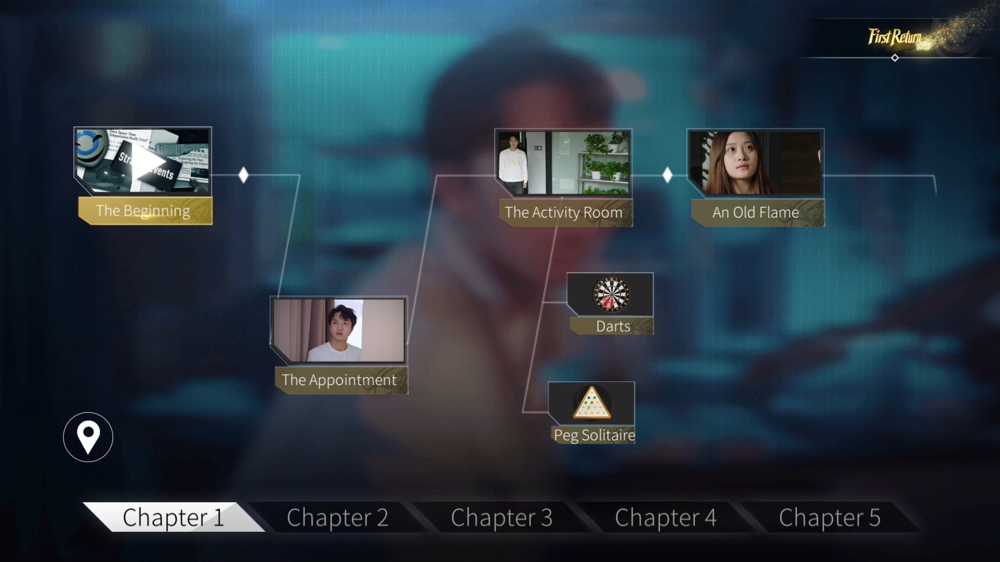

<p align="center">
  <a href="https://store.steampowered.com/app/1925830/MOBIUS_THEORY/">
    
  </a>
</p>

# Mobius Theory — English fan translation

*Mobius Theory* is a live-action mystery combining romance, investigation and
time travel. Reporter Li Weishi is preparing to marry his fiancée, Zhao Yidie,
when an unexpected reunion with his first love, Lin Jianhe, casts doubt on the
past he thought he knew. Follow the clues, solve puzzles and make choices as a
search for answers draws him into a web of love, conspiracy and shifting timelines.

English subtitles, story text, menus and artwork for **轮回之理 — MOBIUS THEORY**,
[Steam app 1925830](https://store.steampowered.com/app/1925830/MOBIUS_THEORY/).

**Version 1.0.0.** The complete Windows release includes 471 subtitle cues across
seven files and 189 artwork replacements covering tutorials, buttons, documents,
computer screens and puzzle labels. Choices, evidence, endings, inner monologues
and text-based menus are translated too.

**[Download the English patch](https://github.com/GeneStarwind09/mobius-theory-english/releases/tag/v1.0.0).**
Choose **Mobius-Theory-English-v1.0.0.zip**, not GitHub's automatic source ZIP.
The owner completed the game in English, performed further QA passes, and
confirmed the final Mind Palace animation/interaction and Close-button repairs.
See [release notes and known issues](docs/RELEASE-1.0.0.md).

## See the translation in game

Original Chinese on the left; the English patch on the right. These screenshots
come from the beginning of the game. Click either image to view it at full size.

### Dialogue and subtitles

| Original Chinese | English patch |
|:---:|:---:|
| [](docs/images/comparison02_ch.jpg) | [](docs/images/comparison02_en.jpg) |

### Documents and evidence

| Original Chinese | English patch |
|:---:|:---:|
| [](docs/images/comparison01_ch.jpg) | [](docs/images/comparison01_en.jpg) |

### Story Map and menus

| Original Chinese | English patch |
|:---:|:---:|
| [](docs/images/comparison03_ch.jpg) | [](docs/images/comparison03_en.jpg) |

## Install

For the native **Linux installer testing build**, see [SteamOS/Linux instructions](docs/LINUX.md).
It applies the same complete translation to the Windows game used by Proton.
Steam Machine installation/playtesting of that new installer is pending.

1. Extract the entire release ZIP, retaining `_internal/` and `artwork/`.
2. Close the game and run `Mobius-English-Patcher.exe`.
3. Select the folder containing `轮回之理.exe`.
4. Click **Check Installation**, then **Install English** and wait for completion.
5. Launch normally through Steam. Enable subtitles in Settings if needed (`字幕`).

Requires a purchased, installed copy of **Steam build 9328697 / game 1.0.20**.
The patcher verifies actual SHA-256 hashes, not just the displayed version.
Allow about 1.5 GB free space for temporary files and backups.

To uninstall, close the game and click **Restore Chinese**. Originals are backed
up in `.mobius-english/original`. Saves are not edited. Steam verification restores
official files but may leave the added `GameOver.srt`; Restore Chinese removes
that tracked file too. Changed files from updates or other mods are rejected.

If upgrading an earlier patch, **Restore Chinese** first, then install this
release. The approved 0.2.4 QA revision has identical game-file replacements to
1.0.0; its tester does not need to reinstall.

## Transparency

- The Python patcher, C# helper, subtitle/translation data and build tools are public.
- Replacements are built from each player's installation; all modified files are backed up.
- Unrelated Unity object bytes and replacement texture pixels are verified after rebuilding.
- The patcher makes no network requests and requires no account.
- Original movies, bundles, assemblies and font data are not distributed.
- The English replacement PNGs and their per-file hashes are included in release assets.

The translation and artwork were developed with AI assistance and human gameplay
QA. This is not a claim of independent professional linguistic certification or
exhaustive testing of every branch, ending, display size and hardware setup.

## Build or run from source

On 64-bit Windows with Python 3.10, clone this repository. For the complete
artwork build, copy **artwork/** from the release ZIP into the checkout before
building. The same PNGs and hashes are available separately in
**Mobius-Theory-English-Artwork-v1.0.0.zip**. Binary artwork is kept in release
assets rather than Git history. Without it, a checkout builds a text-only patcher;
the public Actions artifact is therefore tools/text only.

```powershell
python -m venv .venv
.venv\Scripts\python -m pip install -r requirements.txt
.venv\Scripts\python -m unittest discover -s tests -v
powershell -NoProfile -File tools/build.ps1
```

The build verifies Mono.Cecil 0.11.6 from NuGet, compiles `TextPatch.cs` and
`EnglishWrap.cs` using the Windows .NET Framework compiler, and packages Python
with PyInstaller. No game data is needed to build the tools. Installation reads
the supported game's font resources locally; those files remain unchanged.
Output: `dist/Mobius-Theory-English/`, its ZIP and a SHA-256 checksum.

For a source run, copy `.build/TextPatch.exe`, `Mono.Cecil.dll` and `EnglishWrap.dll`
beside `patcher.py`, then run `python patcher.py`. CLI:
`python patcher.py --action check|install|restore --game "path"`.

Dependencies and build scripts are public. The executable is not code signed,
and bit-for-bit reproducible builds are not claimed. Inspect the source revision
and checksum corresponding to the release you download.

## Contribute

Report issues with the chapter, scene, game build and a screenshot or timestamp.
Mark story spoilers. Subtitle lines, choices and artwork can be reviewed separately.
Use `python tools/validate.py --refresh-hashes` after editing translation payloads.

- [Context and glossary — full spoilers](docs/Context-and-Translation-Notes.md)
- [Artwork editing workflow](docs/ARTWORK.md)
- [Artwork rendering checks](docs/ARTWORK-VALIDATION.md)
- [Contribution guide](CONTRIBUTING.md)
- [Release QA](docs/QA-1.0.0.json)

## Licence and affiliation

Original code, documentation and translation contributions use the [MIT licence](LICENSE).
Original game art, Chinese text, trademarks and third-party software remain
outside that grant. See `licenses/` and `THIRD-PARTY-NOTICES.txt`.
This is an unofficial fan project, unaffiliated with the developer or Valve.
